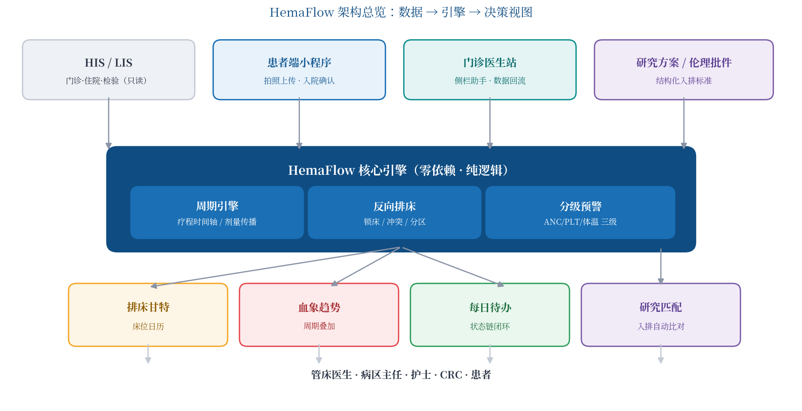

# HemaFlow 血液科治疗周期引擎 · Hematology Treatment Cycle Engine

[简体中文](#中文) | [English](#english)

---

<a name="中文"></a>
## 中文

**HemaFlow** 是一套面向血液科病房的开源核心引擎，把「周期性治疗」这一血液科最独特的业务特征建模为可计算的日历。它由三个纯逻辑模块组成，不依赖任何数据库或外部服务，易于嵌入现有系统、易于测试：

| 模块 | 文件 | 功能 |
|---|---|---|
| 治疗周期引擎 | `hemaflow/engine.py` | 录入方案模板（如 R-CHOP 21d×6），自动生成全疗程时间轴：各周期入院/化疗/出院日、间隔期血象复查节点、中期评估节点；剂量调整可传播至后续周期 |
| 反向排床调度器 | `hemaflow/beds.py` | 床位甘特模型 + 提前预约锁床（reverse booking）+ 冲突检测 + 文本甘特图输出；支持床位标签（如层流床）与首选原床 |
| 分级预警规则引擎 | `hemaflow/alerts.py` | 血常规分级评估（黄/红），阈值按方案可配置；仅计算分级，不做临床决策 |

`hemaflow/synthetic.py` 生成**完全合成**的演示数据（固定随机种子，无任何真实患者数据）。



### 快速开始

```bash
cd hemaflow
python3 demo.py        # 无第三方依赖，Python 3.10+
```

运行后依次输出：某患者全疗程时间轴 → 一周床位甘特与反向锁床结果 → 间隔期血象分级预警。

📖 更详细的接入指引（改科室口径的规则配置、HIS 对接建议、常见问题）见 **[docs/QUICKSTART.md](docs/QUICKSTART.md)**。

### 设计原则

1. **纯逻辑、零依赖**：核心包不引第三方库，方便嵌入 HIS 周边的任何技术栈；
2. **规则可配置**：方案模板与预警阈值均为数据而非硬编码，由科室自行维护；
3. **不做临床决策**：引擎只计算与提醒，所有阈值与最终判断属于医护人员；
4. **合成数据红线**：本仓库任何代码、文档、演示数据中不出现真实患者信息。

### Roadmap

- [x] v0.1 周期引擎 + 反向排床 + 分级预警
- [x] v0.2 规则配置文件化（JSON，保持零依赖）、19 项单元测试、床位约束扩展（男女分区、消毒间隔、床位标签）
- [ ] v0.3 研究入组匹配引擎
- [ ] v0.4 患者端 API 契约（OpenAPI）

### 许可证

AGPL-3.0（全文见 `LICENSE` 文件）。
核心引擎开源；HIS/LIS 对接适配层与托管服务为闭源商业组件。

---

<a name="english"></a>
## English

**HemaFlow** is an open-source core engine for hematology wards. It turns the defining trait of hematology care — **cyclic, long-course treatment with interval periods** — into a computable calendar. Three pure-logic modules, no database, no third-party dependencies:

| Module | File | What it does |
|---|---|---|
| Treatment cycle engine | `hemaflow/engine.py` | From a regimen template (e.g. R-CHOP 21d ×6), generate the full-course timeline: admission / chemo / discharge dates per cycle, interval blood-count checkpoints, mid-course assessments. Dose adjustments propagate to later cycles |
| Reverse bed scheduler | `hemaflow/beds.py` | Bed gantt model with advance reverse-booking, conflict detection, text gantt output; bed tags (e.g. laminar flow) and preferred-bed reuse supported |
| Tiered alert engine | `hemaflow/alerts.py` | Blood-count tiering (yellow/red) with per-regimen configurable thresholds; computes levels only — no clinical decisions |

`hemaflow/synthetic.py` produces **fully synthetic** demo data (fixed seed, never any real patient data).


### Quick start

```bash
cd hemaflow
python3 demo.py        # no third-party deps, Python 3.10+
```

📖 For detailed integration guidance (customizing rule configs for your ward, HIS adapter suggestions, FAQ), see **[docs/QUICKSTART.md](docs/QUICKSTART.md)**.

### Design principles

1. **Pure logic, zero dependencies** — embeddable next to any HIS stack;
2. **Rules as data** — regimen templates and alert thresholds are configuration, owned by clinical teams;
3. **No clinical decisions** — the engine computes and reminds; thresholds and judgments belong to clinicians;
4. **Synthetic-data red line** — no real patient information anywhere in this repository.

### License

AGPL-3.0 (full text in the `LICENSE` file).
The core engines are open source; HIS/LIS adapters and managed hosting are closed-source commercial components.

---

*Disclaimer: not a medical device; not medical advice. Thresholds shown are illustrative defaults for software demonstration only.*
